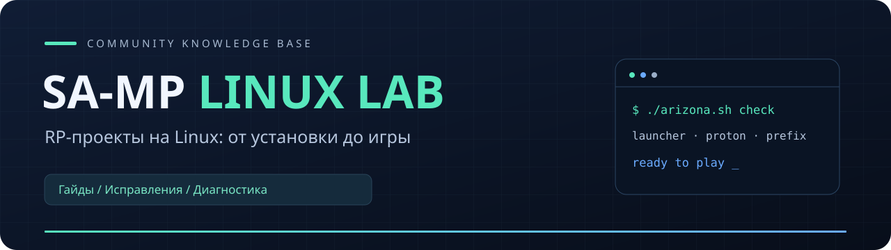

<p align="center"></p>

# Как запустить RP-игры на Linux

**Сначала выберите игру ниже.** Для Arizona и Radmir есть отдельные установщики: они подготовят программы для запуска, скачают официальный лаунчер и добавят ярлык. Потом вы скачаете саму игру в лаунчере и войдёте в аккаунт.

| Что хотите установить | Куда перейти |
| --- | --- |
| **Arizona RP** | [Открыть простую инструкцию](https://github.com/anrhangels/linux-arizona-rp#установка) |
| **Radmir CRMP на GTA San Andreas** | [Открыть простую инструкцию](https://github.com/anrhangels/linux-radmir-rp#установка) |
| **Amazing Online** | [Прочитать технический отчёт](https://github.com/anrhangels/linux-amazing-rp) — игру запустить не удалось, рабочего установщика нет |

## Способ 1. Установка через Git

Git — программа для скачивания проекта с GitHub. В выбранном репозитории сначала идёт инструкция через Git: как проверить его наличие, установить при необходимости, скачать проект и запустить `install.sh`.

**Откройте инструкцию именно своей игры из таблицы выше и выполняйте команды там.** Здесь находятся общие материалы и старые вспомогательные инструменты, а не единый установщик всех игр. Знать Wine или Proton для обычной установки Arizona и Radmir заранее не нужно.

## Способ 2. Скачать ZIP вручную

Если не хотите устанавливать Git, в репозитории выбранной игры нажмите **Code → Download ZIP**. Распакуйте архив, откройте полученную папку, нажмите правой кнопкой на свободном месте → **«Открыть в терминале»** и выполните:

```bash
bash install.sh
```

Этот шаг относится **только к отдельным репозиториям Arizona и Radmir**. ZIP этого общего репозитория и Amazing не содержит такого установщика. Полная инструкция для каждого проекта объясняет, что нажимать, когда вводить пароль и как открыть игру после настройки.

## Что уже проверено

Arizona запускалась на Arch Linux; проверены игровой вход, русский чат, эмодзи и кириллица голосового интерфейса. Radmir CRMP запускался с новой графикой; проверялось исправление музыкальных адресов. Новые установщики прошли автоматические проверки, но полная установка с нуля этими скриптами ещё не перепроверена в игре. На других дистрибутивах игровой результат не подтверждён.

Для Amazing работал лаунчер после .NET 4.8, но клиент завершался с ошибкой. Сам игровой процесс не подтверждён. Запуск лаунчера не равен запуску игры. Подробные результаты и ограничения опубликованы в отдельных репозиториях.

## Общие материалы для опытных пользователей

| Документ | Для чего нужен |
| --- | --- |
| [Документация](docs/README.md) | Справочные материалы и прежние инструкции |
| [Словарь](docs/glossary.md) | Префикс, Proton, Flatpak и другие термины |
| [Инструменты](docs/toolkit.md) | Проверки существующей установки, журналы и восстановление |
| [Поиск ошибок](docs/troubleshooting.md) | Разбор симптомов |
| [История экспериментов](docs/experiments.md) | Что пробовали и что получилось |

Материалы в `docs` отражают историю исследования. Для новой установки начинайте с отдельных репозиториев в верхней таблице: их инструкции учитывают собственные скрипты настройки.

Работа над проектом велась с помощью ИИ — **OpenAI Codex GPT-6.1-Sol**.

Независимый проект сообщества. Документация, код и собственные иллюстрации — [MIT](LICENSE). Клиенты и игровые файлы загружаются из официальных источников и в этот репозиторий не включены.
